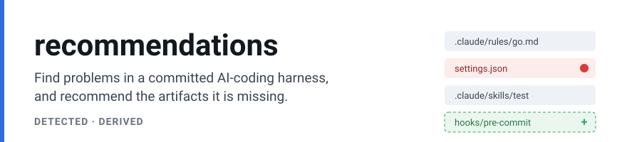
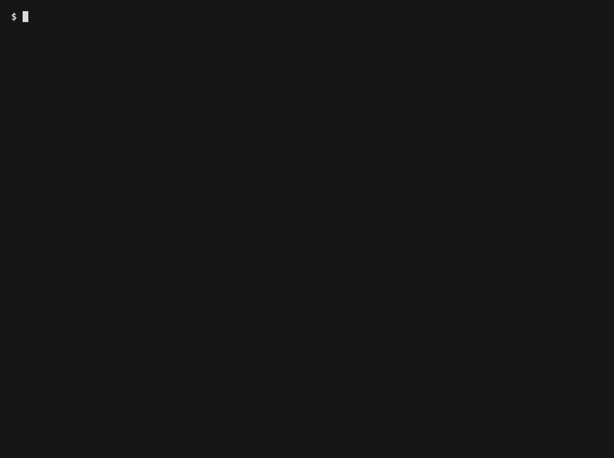

<picture>
  <source media="(prefers-color-scheme: dark)" srcset=".github/assets/banner-dark.svg">
  
</picture>



[](../LICENSE)


A team that runs an AI coding harness across its repositories (rules, skills, agents, commands, hooks and MCP config) watches it drift: artifacts begin to conflict, point at deleted files, and grant more than they should, and nobody can tell which new artifacts the team's own usage calls for. This engine reads a committed harness, reports the problems in it with the evidence for each, and recommends the artifacts it is missing from a team's own coding signals.

**Two lenses:**

- **DETECTED** finds problems in the harness that is already committed: a rule defined twice, a glob that matches no file, an over-broad permission grant.
- **DERIVED** recommends artifacts a repository does not yet have, from the organization's own coding signals: session analyses, review themes and detected security incidents.

## Contents

- [What it does](#what-it-does) lists each entry point and what it is not for.
- [Quick start](#quick-start) runs the DETECTED scan over a sample repository on your machine.
- [Choosing a function](#choosing-a-function) points you at the entry point for what you have.
- [Usage](#usage) gives one complete example for each entry point.
- [Reference](#reference) states the exact rules each entry point follows.
- [Glossary](#glossary) defines the terms this README uses.
- [Before you rely on it](#before-you-rely-on-it) gives the limits that are inherent or by design.
- [Project](#project) covers versioning, tests and the license.

## What it does

- **`recommendations scan --harness-dir <dir> --dsn <dsn>`** scans a repository's committed harness on disk and prints the findings (a rule id defined in two files, a rule pattern that matches nothing, an over-broad or prompt-bypassing permission grant) with a coverage report of what it did and did not look at. See the [quick start](#quick-start).
- **`ondisk.Read`** classifies the harness files in a directory and returns the inventory, with no database and no model. It is the offline way to see what the scan will look at.
- **`ondisk.Scan`** runs that same DETECTED scan from your own Go program and returns the findings as values to filter, route or store.
- **`HarnessImproveEngine.Run` and `.RunOrgScan`** are the full DETECTED engine: the per-repository scan plus the organization-wide scan, with the LLM legs that add behavioural and coverage findings on top of the config-only detectors.
- **`Engine.Run`** is the DERIVED pipeline: it builds a repository's context from the organization's coding signals, asks the model for net-new artifacts, grades them, and persists the ones worth surfacing.
- **`tetriz-py`** is the bundled LLM service the DERIVED pipeline and the generative DETECTED legs call. You supply your own model key. No key ships.

### What it does not do

- It does not apply a fix. It persists findings and recommendations, and a person or a downstream system acts on them.
- It is single-tenant: every record for the organization is processed.
- It ships no model key. The LLM legs read a key from the environment at run time, and degrade to the config-only detectors when no `tetriz-py` is configured.
- The on-disk scan runs the config-only detectors only. The usage-informed and organization-wide lenses need signals a repository walk does not carry.

## Quick start

You need Go 1.26 or newer and a local Postgres. The scan persists its findings, so it writes to a database. It needs no model and makes no network call off your machine. Clone the repository and start a throwaway Postgres:

```sh
git clone https://github.com/tetriz-ai/tetriz-harness.git
cd tetriz-harness
docker run -d --name tetriz-pg -p 127.0.0.1:55432:5432 -e POSTGRES_PASSWORD=postgres postgres:17-alpine
```

Point the scan at any repository's harness files. The bundled sample repository stands in for your own:

```sh
go run ./recommendations/cmd/recommendations scan \
  --harness-dir ./recommendations/ondisk/testdata/sample-repo \
  --dsn "host=localhost port=55432 user=postgres password=postgres dbname=postgres sslmode=disable"
```

```text
scanned ./recommendations/ondisk/testdata/sample-repo: 9 harness artifacts over 11 files; 6 DETECTED finding(s)
  - [HARNESS_FINDING_DIMENSION_SECURITY] Permissions default mode bypasses all prompts (priority 30) [live]
    <finding-id>
  - [HARNESS_FINDING_DIMENSION_CONFLICT] Rule pattern matches no files in the repo (priority 20) [live]
    <finding-id>
  - [HARNESS_FINDING_DIMENSION_SECURITY] Over-broad permission grant (priority 20) [live]
    <finding-id>
  - [HARNESS_FINDING_DIMENSION_SECURITY] Over-broad permission grant (priority 20) [live]
    <finding-id>
  - [HARNESS_FINDING_DIMENSION_CONFLICT] Rule ID defined in more than one file (priority 10) [live]
    <finding-id>
  - [HARNESS_FINDING_DIMENSION_INSTRUCTION_INTENT] Lines are denser than most files in this repo (priority 5) [live]
    <finding-id>

detector coverage:
  ran (config-only, over the committed harness on disk):
    - Conflict (dup-id, dead-glob, broken-path, root-restatement)
    - Instruction-Intent (placement and density over committed instruction files)
    - Security permission inventory (grants and default-mode in a settings.json)
  skipped (need session/usage/org data a repository walk does not provide):
    - Behavioral deviation: needs per-skill usage behavior (session data) and LLM intent classification
    - Personal / never-used: needs per-person usage and primary-repo ownership
    - Org MCP sprawl: needs org-wide MCP usage (the org-relational scan, not wired on disk)
    - Org coverage-gap: needs org-wide signals (the org-relational scan, not wired on disk)
```

The `<finding-id>` on each second line is assigned per scan. Run `docker rm -f tetriz-pg` when you are done. To see what the scanner classifies without a database, run `go run ./recommendations/examples/read-harness-inventory`.

This quickstart is the DETECTED path. Recommending *net-new* artifacts from an organization's signals (DERIVED) is integration-only: it needs that organization's signals loaded into the schema and a running `tetriz-py` with a Gemini key. See [Recommend net-new artifacts (DERIVED)](#recommend-net-new-artifacts-derived) for the exact prerequisites.

## Choosing a function

| You have | Use | Example |
|---|---|---|
| a repository on disk and want its committed-harness findings | `recommendations scan` | [scan-a-repo](examples/scan-a-repo/) |
| a repository on disk and want the findings as Go values | `ondisk.Scan` | [scan-from-go](examples/scan-from-go/) |
| a repository on disk and want only the classified inventory | `ondisk.Read` | [read-harness-inventory](examples/read-harness-inventory/) |
| a detector setting to change, such as the vendor-surface markers | `recommendations.DetectorConfig` | [tune-detectors](examples/tune-detectors/) |

Every entry point here is the DETECTED on-disk path, which needs only a local Postgres. The DERIVED pipeline and the organization-wide DETECTED scan read an onboarded organization's signals from the same schema. The CLI's default run (no `scan` subcommand) runs them over `--org` and `--repos`, and the reference wiring is in [`cmd/recommendations/main.go`](cmd/recommendations/main.go).

## Usage

### Scan a repository's committed harness

When: you want the findings for a repository's harness and you have a local Postgres. The scan reads the harness on disk, seeds a fresh database, runs the config-only detectors, and prints the findings with a coverage report. The complete command and its output are in [scan-a-repo](examples/scan-a-repo/), and the quickstart above runs it.

Remember: `RunMigrations` is idempotent (every statement guards with `IF NOT EXISTS`), so re-scanning the same directory against the same database re-seeds its partition in place rather than failing.

### Run the scan from Go

When: you embed the scan in your own tool and want the findings as values. `ondisk.Scan` opens the database, runs the scan, and returns each finding plus the detector coverage. The complete program is in [scan-from-go](examples/scan-from-go/), and it runs against a Postgres named by `POSTGRES_TEST_DSN`:

```sh
go run ./recommendations/examples/scan-from-go
```

```text
DETECTED findings: 6
  [HARNESS_FINDING_DIMENSION_SECURITY] Permissions default mode bypasses all prompts (priority 30)
  [HARNESS_FINDING_DIMENSION_CONFLICT] Rule pattern matches no files in the repo (priority 20)
  [HARNESS_FINDING_DIMENSION_SECURITY] Over-broad permission grant (priority 20)
  [HARNESS_FINDING_DIMENSION_SECURITY] Over-broad permission grant (priority 20)
  [HARNESS_FINDING_DIMENSION_CONFLICT] Rule ID defined in more than one file (priority 10)
  [HARNESS_FINDING_DIMENSION_INSTRUCTION_INTENT] Lines are denser than most files in this repo (priority 5)
ran 3 detector families; skipped 4 for lack of on-disk input
```

Remember: read `Result.Coverage` to tell a genuinely clean harness from one whose problems need signals a repository walk does not carry.

### Tune the detectors

When: a built-in detector setting does not fit your harness, for example another tool's config path that the vendor-surface lens does not know. Start from `recommendations.DefaultDetectorConfig()`, change only the fields you need, and pass it as `ondisk.Options.DetectorConfig` or to `recommendations.NewHarnessImproveEngine`. Every field you leave unset keeps its built-in value. The complete program is in [tune-detectors](examples/tune-detectors/), and it runs against a Postgres named by `POSTGRES_TEST_DSN`:

```sh
go run ./recommendations/examples/tune-detectors
```

```text
built-in markers: 0 vendor-surface finding(s)
with .windsurfrules added: 1 vendor-surface finding(s)
  [HARNESS_FINDING_DIMENSION_CONFLICT] File points Claude at another tool's config (priority 10)
```

Remember: a list field such as `VendorSurfaceMarkers` replaces the built-in list when set, so append to the default list rather than starting from an empty one.

### Classify the harness without a database

When: you want to see what the scan will look at, with no database. `ondisk.Read` walks a directory and returns the classified inventory. The complete program is in [read-harness-inventory](examples/read-harness-inventory/), and it runs offline:

```sh
go run ./recommendations/examples/read-harness-inventory
```

```text
artifacts: 9 over 11 files
by type:
  HARNESS_ARTIFACT_TYPE_AGENT: 1
  HARNESS_ARTIFACT_TYPE_AGENTS_MD: 1
  HARNESS_ARTIFACT_TYPE_CLAUDE_MD: 1
  HARNESS_ARTIFACT_TYPE_COMMAND: 1
  HARNESS_ARTIFACT_TYPE_HOOK: 1
  HARNESS_ARTIFACT_TYPE_PERMISSIONS: 1
  HARNESS_ARTIFACT_TYPE_RULE: 2
  HARNESS_ARTIFACT_TYPE_SKILL: 1
mcp servers declared: [filesystem]
```

Remember: a `.claude/settings.json` is not itself an artifact. It fans into a PERMISSIONS part and one HOOK part per hook, which the permission lens reads.

### Recommend net-new artifacts (DERIVED)

When: you want the engine to recommend artifacts a repository does not yet have, and you already hold an organization's coding signals in the engine's schema.

**DERIVED is integration-only.** This repository ships no sample signals and no command that runs DERIVED from a fresh clone. Nothing here writes its input tables: you load them yourself, from your own session-analysis, VCS and project-management producers or a dump import. Run it only when you have all of the following:

1. **A Postgres holding the engine's schema.** The CLI applies it on start with `RunMigrations`, from [`migrations/`](migrations/).
2. **The organization's coding signals in that schema**, for the `--org` and `--repos` ids you pass. Each migration's header states what the table mirrors, and the DAO named beside it is the exact read contract (the columns it selects and the filters it applies):

   | Table | Migration | Read by |
   |---|---|---|
   | `session_analyses`, `security_flags` | [`0001_session_signals.sql`](migrations/0001_session_signals.sql) | [`dao/session_insight_repo.go`](dao/session_insight_repo.go), [`dao/session_insight_aggregates.go`](dao/session_insight_aggregates.go), [`dao/security_flag_repo.go`](dao/security_flag_repo.go) |
   | `pull_requests`, `raw_records`, `vcs_repositories`, `vcs_repo_profile` | [`0002_vcs_pr_signals.sql`](migrations/0002_vcs_pr_signals.sql) | [`dao/pull_request_repo.go`](dao/pull_request_repo.go), [`dao/raw_record_repo.go`](dao/raw_record_repo.go), [`dao/repository_repo.go`](dao/repository_repo.go), [`dao/vcs_repo_profile_repo.go`](dao/vcs_repo_profile_repo.go) |
   | `pm_issues`, `pr_issue_mapping_candidates` | [`0003_pm_signals.sql`](migrations/0003_pm_signals.sql) | [`dao/pull_request_repo.go`](dao/pull_request_repo.go) |
   | `harness_artifacts`, `harness_files` | [`0004_harness_inventory.sql`](migrations/0004_harness_inventory.sql) | [`dao/harness_artifact_repo.go`](dao/harness_artifact_repo.go) |
   | `platform_identity_map` | [`0005_identity.sql`](migrations/0005_identity.sql) | [`dao/platform_identity_map_repo.go`](dao/platform_identity_map_repo.go) |

   The interfaces the engine consumes are in [`dao/dao.go`](dao/dao.go), and [`aggregator.go`](aggregator.go) is where it reads them. The engine writes `prompt_library`, `prompt_library_content` and `task_executions` (migrations 0006 to 0008).
3. **A running `tetriz-py` with a Gemini key**, started as [`tetriz-py/README.md`](../tetriz-py/README.md) shows. Review themes are classified through Gemini by default. For the local classifier, set `TETRIZ_THEME_CLASSIFIER_STRATEGY=sbert` and install the `ml` extra; deriving the artifacts still needs the Gemini key.

The pipeline is `Engine.Run`, wired in [`cmd/recommendations/main.go`](cmd/recommendations/main.go) under the CLI's default run (no `scan` subcommand), which also runs the per-repository and organization-wide DETECTED scans:

```sh
# Integration only: needs the signals above in the DSN's schema and a running tetriz-py with a Gemini key.
go run ./recommendations/cmd/recommendations --org <org-id> --repos <repo-id> --dsn "<postgres dsn>" --tetriz-py-url http://127.0.0.1:8000
```

The CLI prints no recommendations. Each DERIVED run records its outcome in its `task_executions` row: `TASK_EXECUTION_STATUS_COMPLETED` when it persisted visible artifacts to `prompt_library`, `TASK_EXECUTION_STATUS_COMPLETED_NO_VISIBLE` when none passed the quality gate, and `TASK_EXECUTION_STATUS_FAILED` with the reason in `error_message` when it could not build its context or reach the model.

A DERIVED recommendation is a persisted artifact rather than console output. Each one carries:

- a **type**: the kind of artifact to add, `HOOK`, `AGENT` or `RULE`;
- a **scope**: the repository (or organization) it is recommended for;
- a **title** and body the model proposed; and
- the **evidence**: the coding signals that motivated it (the review themes, session behaviour or incidents behind the recommendation).

Remember: with no `tetriz-py` configured the DERIVED legs degrade to a no-op and only the DETECTED detectors persist findings. The config-only scan above is what runs offline, not the whole of what the engine does.

From the repository root, run `go doc ./recommendations` for the API. Every runnable example is listed in [examples/README.md](examples/README.md).

## Reference

### `recommendations scan` and `ondisk.Scan`

- **Config-only on disk.** It runs the Conflict detectors, the Instruction-Intent detector and the security permission inventory, which need only the committed files. The usage-informed and organization-wide lenses do not run on disk.
- **Coverage is always reported.** `Result.Coverage` names the families that ran and the families skipped with the input each needs, so a zero-finding scan is never read as a clean bill of health.
- **Re-scannable in place and single-tenant.** `RunMigrations` is idempotent (every statement guards with `IF NOT EXISTS`); a scan re-seeds its own `(org, repo)` partition in place, so re-scanning the same directory reconciles rather than duplicating, and every record is processed.
- **Committed scope only.** It wires the `REPO_COMMITTED` scope. A user-global or repo-local personal harness can be read but its lenses need per-person usage.

### `ondisk.Read`

- **Pure disk, no database.** It walks the directory, skips `.git`, and never fails on a file it cannot read.
- **Bodies are capped.** A file over 4 MiB is recorded as a path but not read as a harness body.
- **Settings fan out.** A `.claude/settings.json` becomes a PERMISSIONS part and one HOOK part per hook; the carrier file is not itself an artifact.
- **MCP servers are collected, not scored.** Declared MCP servers are returned for completeness; the per-repository path does not consume them.

## Glossary

| Term | What it means |
|---|---|
| Harness | The files that configure an AI coding agent in a repository: rules, skills, agents, commands, hooks, `CLAUDE.md`, `AGENTS.md` and MCP config. |
| Artifact | One harness file the engine classifies and reasons about, such as a rule or a skill. |
| Finding | One DETECTED result: a dimension, a title, a priority and the evidence behind it. |
| Dimension | The kind of problem a finding is about: conflict, instruction-intent or security. |
| Coverage | The report of which detector families a scan ran and which it skipped for lack of input. |
| Scope | Where a harness lives: committed to a repository, local to a checkout, or user-global. |

## Before you rely on it

Check these before you run the engine on a harness that matters. Each is pinned by a test.

### Coverage

- **Misses, on disk, everything the usage and organization lenses would find.** The on-disk scan runs only the config-only detectors; behavioural deviation, personal and never-used, organization MCP sprawl and coverage-gap need session, usage or organization-wide signals a repository walk does not carry. The skipped families are named in `Result.Coverage`, not dropped silently. Pinned by `ondisk/scan_test.go`.
- **Only the committed harness is wired on disk.** A user-global or repo-local personal harness can be read and seeded, but the lenses that act on it need per-person usage, so they yield nothing on disk. Pinned by `ondisk/scan_test.go` and the `ondisk` package doc.
- **`.gitignore` is honoured only inside a git checkout.** When `--harness-dir` is a git work tree, git-ignored files and directories (a `node_modules/` tree, build output) are excluded from both the file count and the dead-glob/broken-path match set, so a rule matching only an ignored file is reported dead. Outside a git checkout there is no work tree for git to resolve ignores against, so every file is counted. Point the scan at a checkout to get ignore-awareness. Pinned by `ondisk/reader_test.go`.

### Running it

- **The generative legs need a model.** With no `tetriz-py` configured, the DERIVED pipeline and the behavioural and fix legs degrade to a no-op, and only the config-only detectors persist findings. Pinned by `e2e_test.go`, which runs the DETECTED scan with the no-op client and asserts the findings still persist.
- **Single-tenant.** Every record for the organization is processed. Pinned by the DAO tests, which read every matching record for the org.
- **Re-scans keep history; the table grows.** Each scan persists its findings and reconciles `is_latest`: the live view (and the CLI's count) is the set where `is_latest = true AND surface_state = VISIBLE`, so re-scanning an unchanged harness leaves the live set stable. Superseded rows are retained as history (`is_latest = false`), including lower-priority findings that did not surface, so `prompt_library` grows by one version-set per scan. An operator running the scan on a schedule can prune `is_latest = false` rows to bound growth; the live view does not depend on them. Pinned by the re-scan idempotency tests in `ondisk/scan_test.go`.

## Project

### Versioning and compatibility

Versions are `0.x`: any minor version can change the public API and the proto package path. The project follows semantic versioning, and a change to an exported signature is breaking. The toolchain floor is Go 1.26.0.

### Tests

`go test ./recommendations/...` runs the unit suites offline. The DAO and on-disk tests need Postgres: they skip when `POSTGRES_TEST_DSN` is unset and fail when it is set but the database cannot be reached; [CONTRIBUTING.md](../CONTRIBUTING.md) shows the setup. `recommendations/scripts/run-examples.sh` runs every example and compares its output to its README.

### Contributing, security and license

- Read [CONTRIBUTING.md](../CONTRIBUTING.md) to build, test and lint. Every pull request needs a test.
- Report a security vulnerability privately, following [SECURITY.md](../SECURITY.md). Do not open a public issue for it.
- The code is MIT-licensed, in [LICENSE](../LICENSE). Copyright 2026 Workloom Solutions Private Limited. Contributors are listed in [CONTRIBUTORS.md](../CONTRIBUTORS.md).
